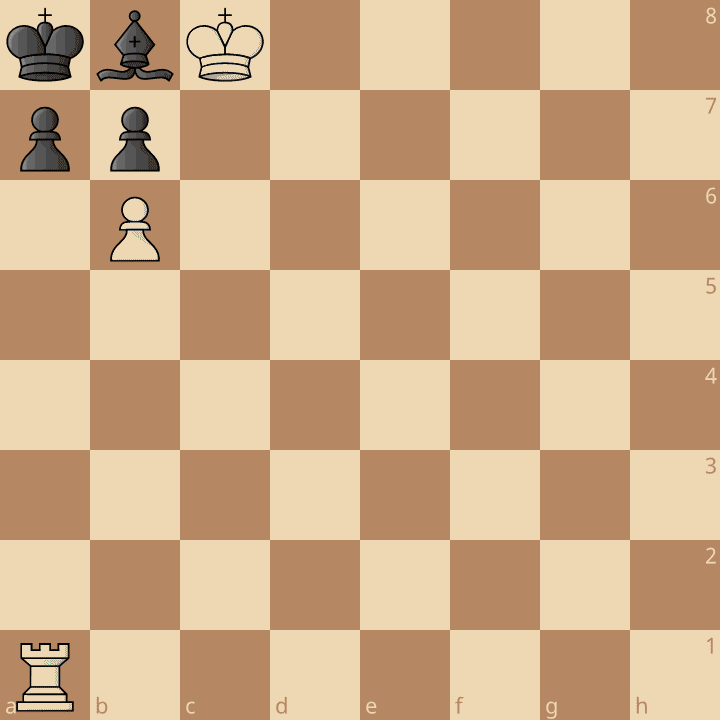

# Marcin Wiśniewski

### 🎓 3rd Year Computer Science Student
Focusing on systems programming, embedded and software engineering.

---
**I'm currently working on:** Unix Shell in C

**I'm currently learning:** Memory management, Algorithms, System programming and Embedded Linux

**Languages & Tools:**

  
  
  
  
  
  
  

---
**📊 Most Used Languages**

  

---
**🛠️ Projects**

**♟️ [Rust Chess Engine](https://github.com/M4rcinWisniewski/RustChessEngine)** — A simple chess engine written in Rust, implementing a Negamax search algorithm. Currently supports move generation and evaluation, with a basic Negamax search. Alpha-beta pruning and more are planned for future improvements.

`Rust` · ⭐ 12

**⌨️ [mini-Unix Shell](https://github.com/M4rcinWisniewski/minimal_unix_shell)** — A minimal Unix shell implementation in C, supporting core shell functionality.

`C`

  

  <i><b>♟️ Paul Morphy's Famous "Zugzwang" Puzzle</b> 
  White to move and mate in 2. Can you find the genius block? You've got a few seconds!</i>

